

# 🚖 Uber Ride & Revenue Analytics
### Power BI | Data Analytics | Business Intelligence

**An interactive dashboard project exploring booking performance, revenue, customer behavior, vehicle categories, payment methods, ride timing and pickup locations.**

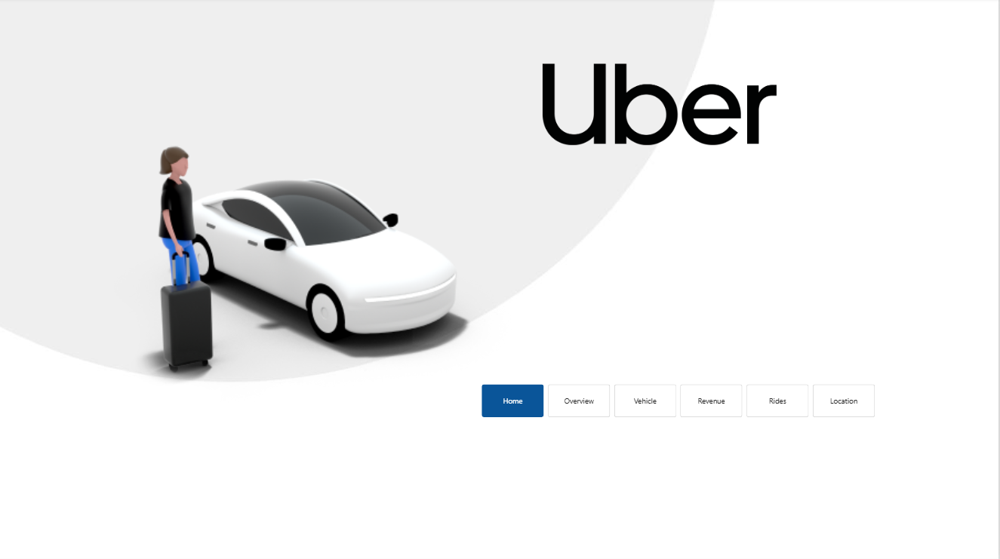

 

---

## 📌 Project Overview

This project analyzes Uber ride-booking data using **Microsoft Power BI** to turn raw data into interactive business insights.

The dashboard is designed to help explore:

- Ride booking and completion performance
- Revenue trends across months and vehicle types
- Booking cancellations and incomplete rides
- Customer and driver ratings
- Payment method preferences
- Ride demand by time slot, weekday and pickup location

The report includes interactive navigation and filters to explore the data at an overall level and by individual vehicle categories.

---

## 🎯 Business Questions

1. How many bookings were completed, cancelled or left incomplete?
2. What is the total revenue and how does it change over time?
3. Which vehicle categories generate the highest revenue?
4. Which payment methods are most frequently used and generate the most revenue?
5. Which time slots have the highest ride demand?
6. Which pickup locations have the highest booking counts?
7. How do customer and driver ratings compare?
8. How does performance change when a specific vehicle type is selected?

---

## 📊 Dashboard Pages

### 🏠 Home & Overview
The overview page summarizes the major KPIs and booking trends.

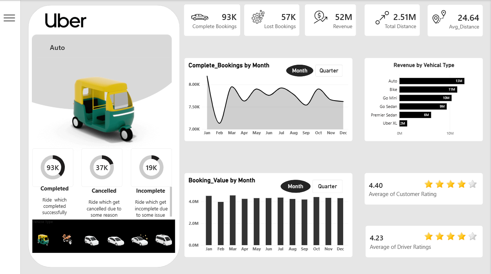

**Key KPIs**
- Completed Bookings
- Lost Bookings
- Revenue
- Total Distance
- Average Distance

---

### 🚗 Vehicle Analysis
Compare vehicle categories across revenue, customer count and completed bookings. The report also supports filtering by vehicle type.

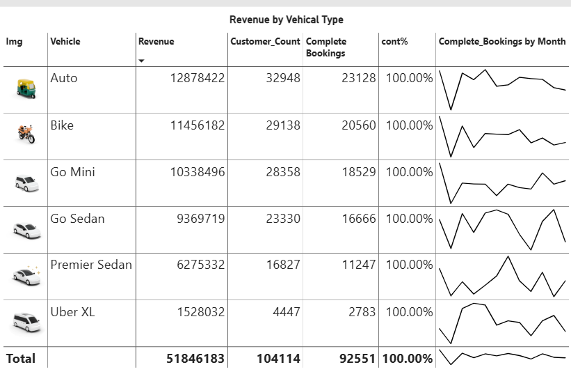

**Vehicle categories analyzed:** Auto, Bike, Go Mini, Go Sedan, Premier Sedan and Uber XL.

---

### 💰 Revenue Analysis
Explore monthly revenue patterns, revenue by vehicle category, payment method and customer.

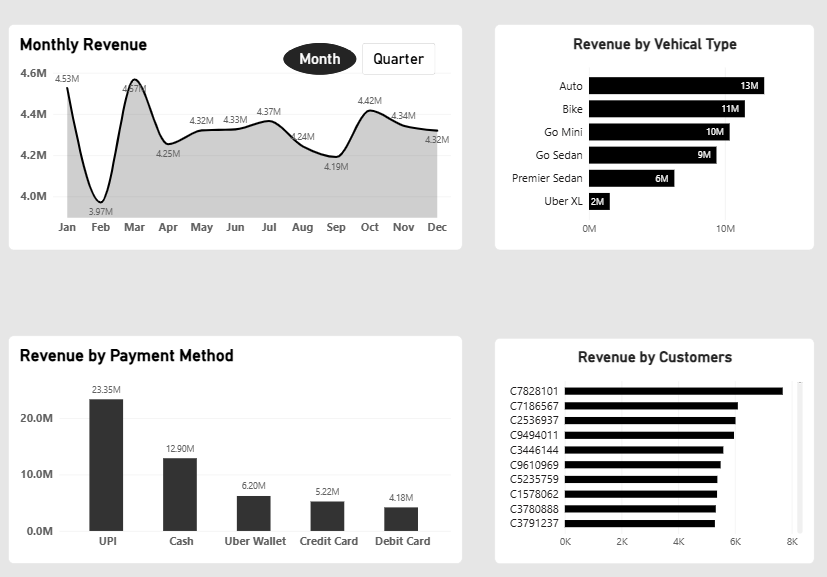

---

### ❌ Booking & Customer Analysis
Analyze cancellation behavior, customer booking trends, vehicle usage and payment preferences.

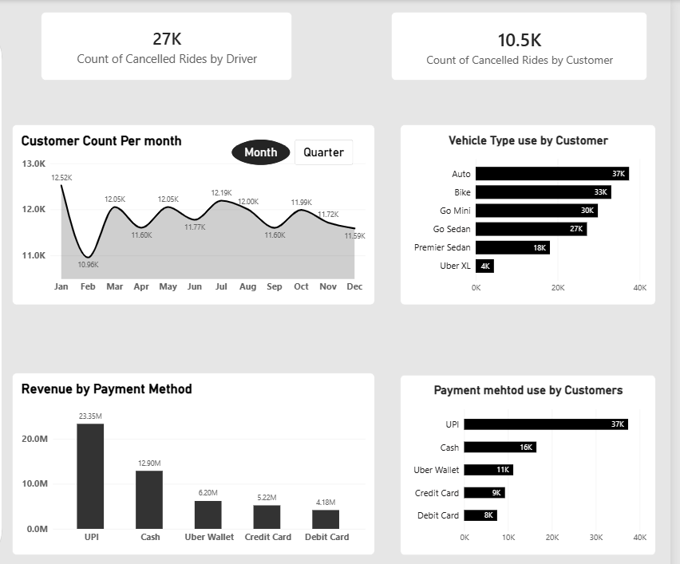

---

### 🕒 Ride Time & Location Analysis
Explore booking demand by time slot and weekday, vehicle usage and popular pickup locations.

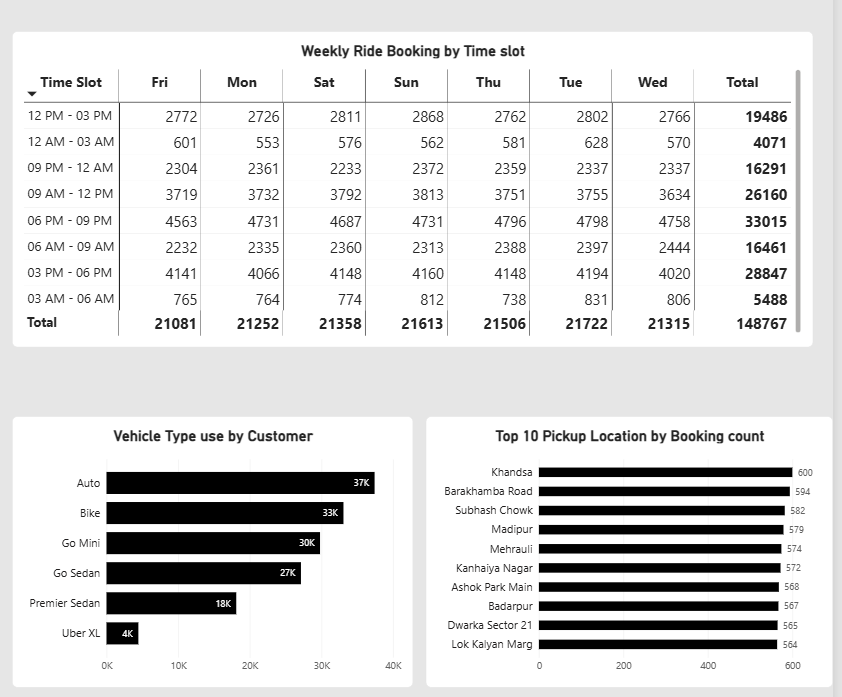

---

## 🔍 Key Insights

> Insights below are based on the figures visible in the dashboard screenshots.

### 📈 Overall Performance
- **148,767 total bookings** were analyzed.
- **92,551 bookings were completed.**
- Approximately **56,216 bookings were cancelled or incomplete**.
- Total revenue shown in the dashboard is approximately **51.85M**.
- Total distance recorded is approximately **2.51M**.
- Average customer rating: **4.40 / 5**.
- Average driver rating: **4.23 / 5**.

### 🚘 Revenue by Vehicle Type

| Vehicle Type | Revenue |
|---|---:|
| Auto | 12.88M |
| Bike | 11.46M |
| Go Mini | 10.33M |
| Go Sedan | 9.37M |
| Premier Sedan | 6.28M |
| Uber XL | 1.53M |

- **Auto** is the highest revenue-generating category in the overall dashboard.
- **Bike** and **Go Mini** are also major revenue contributors.
- Uber XL contributes the lowest revenue among the listed vehicle types.

### 💳 Revenue by Payment Method

| Payment Method | Revenue |
|---|---:|
| UPI | 23.35M |
| Cash | 12.90M |
| Uber Wallet | 6.20M |
| Credit Card | 5.22M |
| Debit Card | 4.18M |

- **UPI is the leading payment method**, contributing approximately 23.35M.
- Cash is the second-largest payment channel.
- Digital payment options collectively form a major part of the revenue mix.

### 🕒 Booking Demand by Time Slot

| Time Slot | Bookings |
|---|---:|
| 06 PM – 09 PM | 33,015 |
| 03 PM – 06 PM | 28,847 |
| 09 AM – 12 PM | 26,160 |
| 12 PM – 03 PM | 19,486 |
| 09 PM – 12 AM | 16,291 |
| 06 AM – 09 AM | 16,461 |
| 03 AM – 06 AM | 5,488 |
| 12 AM – 03 AM | 4,071 |

- **6 PM–9 PM is the busiest time slot** in the overall time-slot analysis.
- Afternoon and evening periods account for a large share of bookings.
- The early-morning and midnight periods show comparatively lower demand.

### 📍 Pickup Locations

The dashboard's top pickup-location chart highlights locations with high booking counts, including:

- Khandsa
- Barakhamba Road
- Subhash Chowk
- Madipur
- Mehruli
- Kanhaiya Nagar
- Ashok Park Main
- Badarpur
- Dwarka Sector 21
- Lok Kalyan Marg

These locations can be explored further to understand demand concentration and potential supply planning.

---

## 🧰 Tools & Skills

| Tool / Skill | Application |
|---|---|
| **Power BI** | Dashboard design, interactive reports and visual analytics |
| **Power Query** | Data cleaning and transformation |
| **DAX** | Measures, calculations and KPI logic |
| **Data Modeling** | Structuring data for analysis |
| **Data Visualization** | Charts, cards, tables and trend analysis |
| **Business Analysis** | Identifying patterns and translating them into insights |

---

## ⚙️ Dashboard Features

- Interactive vehicle-type selection
- KPI cards for high-level performance
- Month and quarter trend views
- Revenue and booking comparisons
- Payment method analysis
- Customer and driver rating KPIs
- Booking status breakdown
- Time-slot and weekday matrix
- Pickup location ranking
- Navigation between dashboard sections

---

## 🖼️ Vehicle-Type Drill-Downs

The dashboard can be explored by vehicle category, allowing users to compare the booking and revenue patterns for different ride types.

<b>View Auto analysis</b>

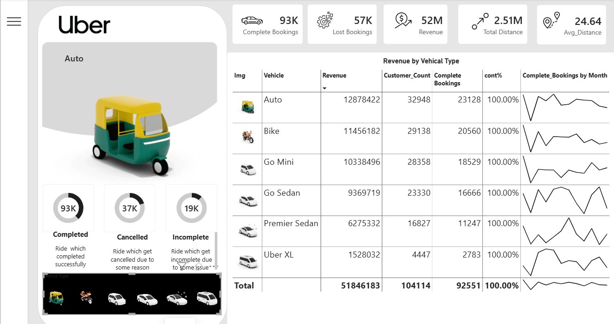

<b>View Bike analysis</b>

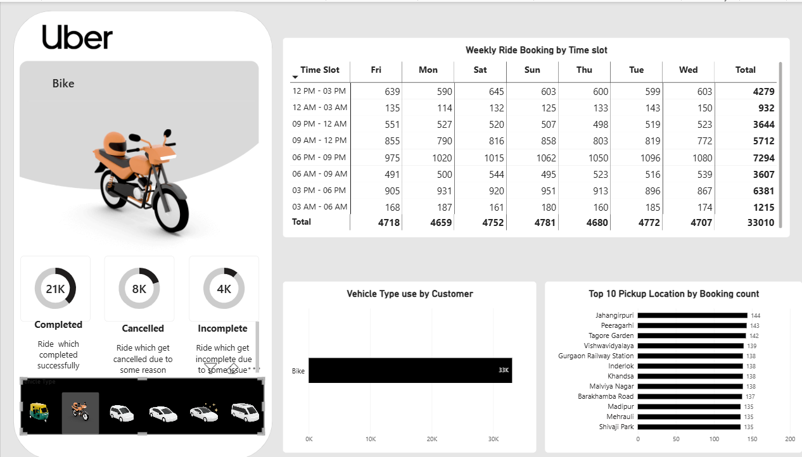

<b>View Go Sedan analysis</b>

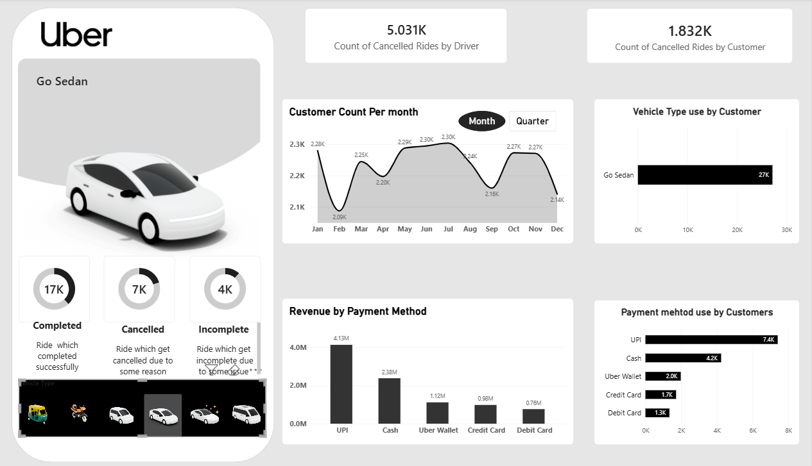

<b>View Premier Sedan analysis</b>

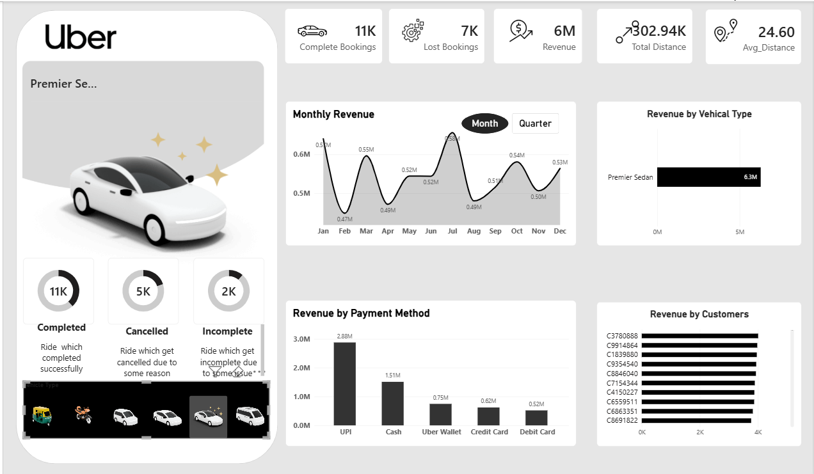

<b>View Uber XL analysis</b>

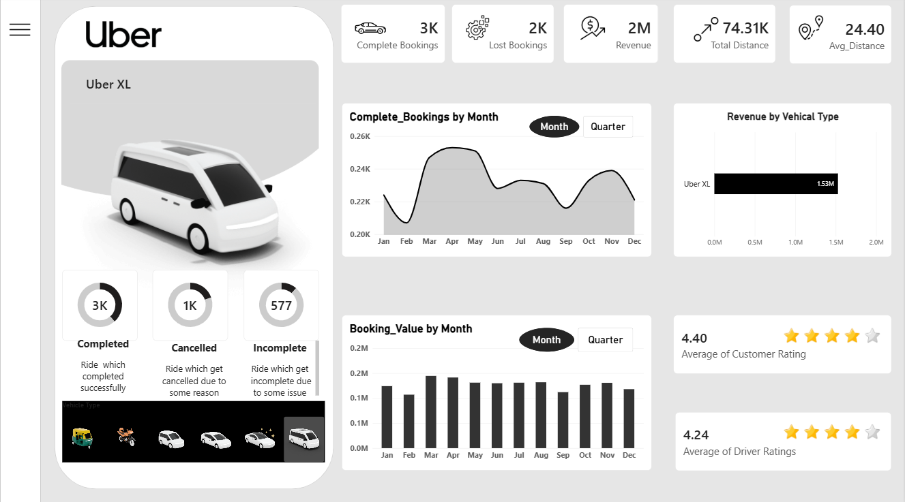

---

## 💡 Recommendations & Business Opportunities

Based on the dashboard findings, potential areas for further investigation include:

- **Peak-hour supply planning:** Review driver availability during the 6 PM–9 PM demand peak.
- **Booking loss analysis:** Investigate the reasons behind cancelled and incomplete bookings.
- **Vehicle category strategy:** Explore what drives demand and revenue for Auto, Bike and Go Mini.
- **Payment experience:** Review the strong UPI preference and ensure smooth payment experiences.
- **Location-based planning:** Study high-volume pickup points to improve driver positioning.
- **Customer experience:** Explore rating patterns and identify factors that may influence customer and driver ratings.

*These are analytical recommendations and would require additional investigation before implementation.*

---

## 📚 What I Learned

Through this project, I practiced:

- Building a multi-page Power BI report
- Designing an interactive dashboard layout
- Creating and displaying business KPIs
- Analyzing revenue and booking trends
- Comparing categories and payment methods
- Exploring demand patterns by time and location
- Turning dashboard findings into business-oriented insights

---

## 🚀 Project Goal

**The goal was not just to visualize data—but to make it easier to understand business performance, identify trends, and support data-driven decision-making.**

---

### 📊 Data → Insights → Better Decisions

**Thank you for exploring this project!**

